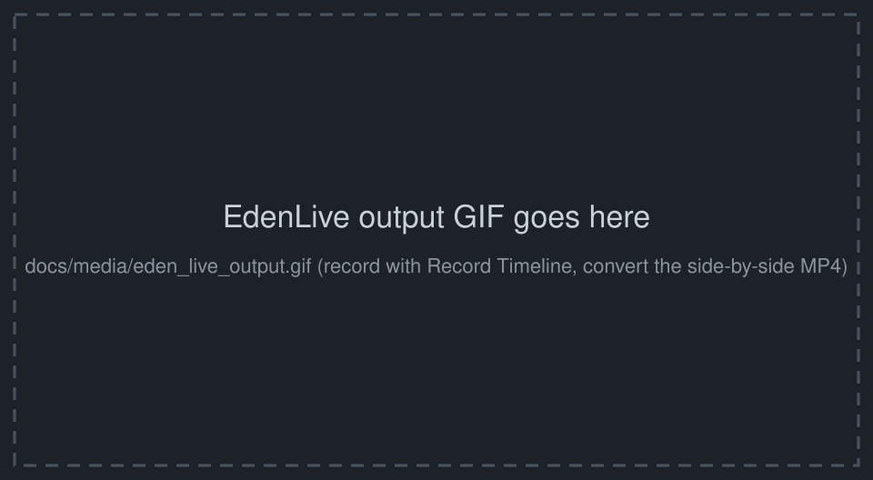
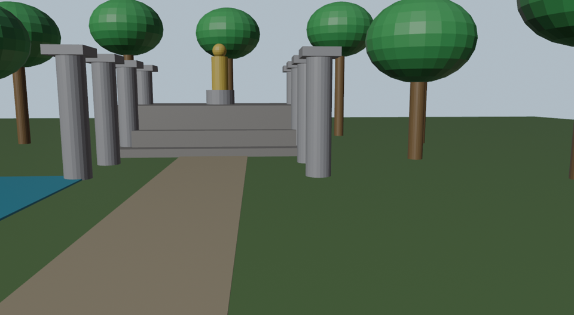
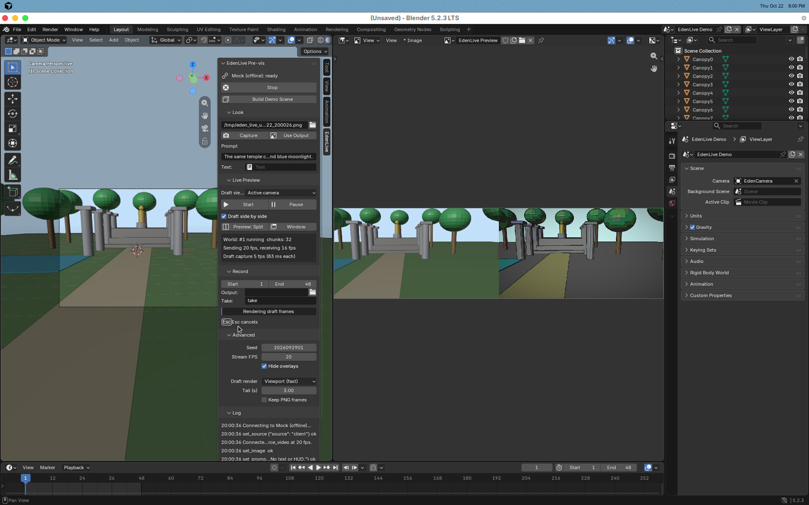

# EdenLive Pre-vis for Blender

Turn a Blender scene made of colored cubes into a live, detailed AI pre-vis. The add-on
streams your camera view to [Reactor](https://reactor.inc)'s **EdenLive** world model
(`reactor/eden-live`, by VAST) and shows the generated world in Blender as you move the
camera, edit the scene, or change the prompt. It can also play your timeline through the
model and save the result as MP4.

Your scene sets the layout, camera and motion. A reference image and a text prompt set the
look.

| | |
|---|---|
|  |  |
| *Placeholder: drop a GIF of real EdenLive output here (`docs/media/eden_live_output.gif`).* | *The demo scene's draft: primitives only.* |


*The EdenLive sidebar while recording, with the split preview (draft on the left, output on the
right). This screenshot uses the built-in **offline mock** backend, which only repaints the
draft. Real EdenLive output is far more detailed.*

---

## Contents

- [Requirements](#requirements)
- [Install](#install)
- [Get a Reactor API key](#get-a-reactor-api-key)
- [Quick start](#quick-start)
- [Demo: colored cubes to a jungle temple](#demo-colored-cubes-to-a-jungle-temple)
- [Recording to MP4](#recording-to-mp4)
- [Architecture](#architecture)
- [Troubleshooting](#troubleshooting)
- [Development](#development)
- [License](#license)

## Requirements

- **Blender 4.2 or newer** (tested on 4.2.3 LTS and 5.2.3 LTS, which bundle Python 3.11 and
  3.13). Installs as a Blender extension. A legacy add-on zip is provided as well.
- **OS**: Windows x64, macOS 11+ on Apple Silicon or macOS 13+ on Intel, Linux x64 with glibc
  2.34+ (Ubuntu 22.04+, Debian 12+, RHEL 9+). These are the platforms the Reactor Python SDK
  ships native builds for.
- **A Reactor account and API key.** EdenLive sessions are billed per session time; see
  [Reactor billing](https://docs.reactor.inc/resources/billing).
- A GPU helps: the draft is drawn with the viewport's OpenGL/Metal/Vulkan renderer.

## Install

### Option A: extension zip (recommended)

1. Download the zip for your platform from the Releases/CI artifacts, or
   [build it yourself](#build-the-zips):
   `eden_live_previs-0.1.0-windows_x64.zip`, `-macos_arm64.zip`, `-macos_x64.zip` or
   `-linux_x64.zip`.
2. In Blender: **Edit > Preferences > Get Extensions > ⌄ (top right) > Install from Disk...**
   and pick the zip, or drag the zip onto Blender's window.
3. Enable **Edit > Preferences > System > Network > Allow Online Access**. Blender blocks
   extensions from going online without it.

The zip bundles the Reactor Python SDK wheel for your platform. Blender installs it for you;
there is nothing to pip-install.

### Option B: legacy add-on zip, or a git checkout

`eden_live_previs-0.1.0-legacy-addon.zip` (or the `eden_live_previs/` folder linked into your
`scripts/addons`) contains no wheels. After enabling it, open the add-on's preferences and click
**Install Reactor SDK**. That runs Blender's own Python
`-m pip install --target <your Blender user dir>/scripts/eden_live_deps/py311 reactor-sdk`
in the background. It needs online access, and you only do it once.

### Build the zips

```bash
python3 tools/build_extension.py --blender /path/to/blender
# dist/eden_live_previs-0.1.0-{windows_x64,macos_arm64,macos_x64,linux_x64}.zip
# dist/eden_live_previs-0.1.0-legacy-addon.zip
```

The script downloads the four `reactor-sdk` wheels pinned in `blender_manifest.toml` from PyPI,
verifies their SHA-256, then runs Blender's
`extension build --split-platforms` and `extension validate`. CI does the same on every push and
uploads the zips as artifacts.

## Get a Reactor API key

1. Sign up at [reactor.inc](https://reactor.inc).
2. Open the [dashboard](https://reactor.inc/dashboard), click your user icon, then **API Keys**
   and create a key. It starts with `rk_`.
3. Paste it into **Preferences > Add-ons > EdenLive Pre-vis > Reactor API Key**, or into the key
   field at the top of the EdenLive sidebar. Both edit the same setting.

Where the key lives: Blender's *user preferences* (`userpref.blend`), never your `.blend` scene
files, so you can share scenes safely. The field is a password field, and the add-on never
logs the key; error messages are scrubbed of it. If the field is empty, the `REACTOR_API_KEY`
environment variable is used. The Reactor Python SDK exchanges the key for a short-lived,
session-scoped token on connect, so the key itself is only sent to `api.reactor.inc/tokens`.

## Quick start

Open the sidebar in the 3D Viewport (**N**), then the **EdenLive** tab.

1. **Connect.** Opens a session on `reactor/eden-live` (GPU assignment can take a moment) and
   starts streaming the draft view as `source_video` at the chosen *Stream FPS*.
2. **Look > Reference.** Pick a PNG, JPEG or WebP, or click **Capture** to save the current
   camera view and use it.
3. **Look > Prompt.** Describe the world you want. With *Send edits live* on, edits are sent with
   `set_prompt` about 0.6 s after you stop typing and apply from the next generated chunk. For
   long prompts, point *Text* at a Text datablock.
4. **Start.** Uploads the reference, stages the prompt and creates a world.
5. **Preview: Split** shows the output next to your viewport, and **Window** opens a separate
   window (e.g. for a second monitor). Tick **Draft side by side** to see the returned
   `draft_video` next to the generated `main_video`.
6. Move the camera, animate, edit. Expect about 1 s of latency. **Pause** holds the world;
   **Stop** ends the session, which also ends billing.

The live preview is an ordinary Blender image called **EdenLive Preview**, so you can also show
it in any Image Editor.

## Demo: colored cubes to a jungle temple

1. **Build Demo Scene** (in the sidebar) creates a new scene of colored primitives: grey
   pillars, stepped platforms, a gold statue, sphere-canopy trees, a blue pond and a sand path.
   It also adds a 5-second camera push-in and a matching prompt. (Headless equivalent:
   `blender --python examples/build_demo_scene.py`.)
2. Set the 3D Viewport to camera view (**Numpad 0**). The demo uses Solid shading with *Object*
   colors, which is exactly the flat, readable draft EdenLive wants.
3. **Make the reference.** Click **Capture**. For the best result, follow the
   [prompt guide](https://docs.reactor.inc/model-api-reference/eden-live/prompt-guide): restyle
   the captured frame in an image tool while keeping the camera angle and object positions, then
   pick the restyled image as the reference. A raw draft as reference produces output that
   looks like the draft. A few example restyle instructions:
   > Restyle this as a sunlit ancient jungle temple courtyard, cinematic and realistic:
   > weathered stone pillars, mossy steps, a carved golden statue, tropical trees, a turquoise
   > pond. Keep the camera angle, perspective and positions of every object.
4. **Connect, Start**, then scrub or play the timeline and watch the world follow the camera.
   Try a prompt edit such as *"...at night, lit by torches and blue moonlight"*.
5. **Record Timeline** to get an MP4 of the whole shot.

Tips from the EdenLive docs: give each object a clear silhouette and its own color, keep the
camera smooth, keep text and HUD out of the draft, and render at 1280×704 (the add-on does this
for the camera view). EdenLive scales drafts to cover 1280×704 and center-crops them, so the demo
scene uses that exact resolution.

## Recording to MP4

**Record > Record Timeline** works in three stages:

1. **Render drafts.** Each frame of the scene's frame range is drawn from the active camera at
   1280×704. *Viewport (fast)* uses the 3D Viewport's shading. *Render engine* renders with the
   scene's engine, so use Workbench or EEVEE. Rendering may be slower than real time; that's fine
   because nothing streams yet.
2. **Stream.** The add-on starts a fresh world, holds the first frame until EdenLive returns its
   first chunk, then plays the frames at exactly the scene's fps (clamped to 10-60), and holds the
   last frame for *Tail* seconds to collect delayed output. It then pauses the world. Returned
   frames are written to disk as they arrive.
3. **Align and encode.** Returned `draft_video` frames are matched back to the frames that were
   sent, so each generated frame lands on its timeline frame. The add-on uses frame tags when the
   model echoes them, otherwise thumbnail matching plus the measured latency.

Outputs, in *Output* (default `//eden_live_renders/`):

| File | Contents |
|---|---|
| `<take>_main.mp4` | Generated video, one frame per timeline frame, at scene fps. |
| `<take>_side_by_side.mp4` | Returned draft (left) next to the generated frame (right), 2560×704. |
| `<take>_raw.mp4` | Everything EdenLive returned, in arrival order, at the stream rate. |
| `<take>_report.json` | Frame counts, measured latency, alignment coverage, prompt, seed. |

Encoding uses `ffmpeg` in the background, if it can find one: the path set in preferences,
then PATH, then the usual install locations (`/opt/homebrew/bin`, `/usr/local/bin`,
`/opt/local/bin`, `/usr/bin`, and on Windows `%ProgramFiles%\ffmpeg\bin`, `C:\ffmpeg\bin` and
Scoop). That matters on macOS, where Blender started from the Dock doesn't see your shell's PATH.
Without ffmpeg, or if ffmpeg fails, the add-on encodes with Blender's built-in FFmpeg through a
temporary Video Sequencer scene, so no external tools are needed. Press **Esc** to cancel a
recording.

If encoding fails anyway, the frames are never thrown away. The error names the folder that
holds the PNG sequences (`<take>_work/seq/main` is the aligned output, `seq/draft` is the
draft, `seq/raw` is the raw stream), and **Open Frames Folder** appears under Record. Encode
them with any tool, e.g.
`ffmpeg -framerate 24 -i <take>_work/seq/main/f_%06d.png -c:v libx264 -pix_fmt yuv420p out.mp4`.

## Architecture

```
 Blender main thread                         background threads (no bpy)
 ───────────────────                         ───────────────────────────
 bpy timer (60 Hz) ── request draft ──┐      EdenLiveSender ── push_frame @ fixed fps ──► source_video
 3D Viewport draw callback ◄──────────┘        (repeats newest frame, stamps scheduled time)
   GPUOffScreen.draw_view3d(camera) ── frame ─► session.source
 Record modal operator ── pre-rendered drafts (memmap) ─► PlaylistProvider ─┘
                                             EdenLiveLoop (asyncio) ── reactor_sdk.Reactor
                                               connect / upload_file / send_command
 Preview Image  ◄── foreach_set ◄── EdenLivePreview ◄── main_video / draft_video (SDK thread)
 Sidebar panel  ◄── polls session.state ◄── state_update messages
                                             EdenLiveWriter ── PNG frames ─► align ─► MP4
```

**In-process SDK with bundled wheels, not a sidecar.** The Reactor Python SDK (`reactor-sdk`)
is pure Python over a prebuilt native library (Rust + libwebrtc). It has no Python
dependencies, ships `py3-none` wheels for every desktop platform Blender supports, and runs on
Blender's bundled Python 3.11 (verified). Blender 4.2's extension format is built for exactly
this: list the wheels in `blender_manifest.toml`, build one zip per platform, and Blender
installs the wheel itself. There is no runtime pip, no compiler and no second Python install.
A sidecar process would add a second interpreter to ship, an IPC protocol for 30 MB/s of frames,
and process-lifecycle failure modes, all to solve a problem we don't have. The legacy-zip
**Install Reactor SDK** button (Blender's own `python -m pip --target <user dir>`) is the
fallback for git checkouts and the legacy add-on zip. aiortc/PyAV aren't needed: the SDK
does the WebRTC itself.

**Never blocking the UI.** Networking, commands and uploads run on a private asyncio loop
thread. Frame pushes run on a dedicated sender thread at a fixed rate. Frame conversion for
the preview and PNG writing run on their own threads. The main thread only captures (a few ms
on a GPU), copies preview pixels into an Image, and draws the panel.

**Steady frame rate.** EdenLive wants steady 10-60 fps, and its output plays at the rate frames
arrive. The sender thread pushes the newest captured frame on a fixed schedule, repeating it if
Blender is busy, and stamps each frame with its *scheduled* time through the SDK's
`capture_time_us`. So even when the main thread holds Python's GIL for a moment, the model sees
evenly spaced frames. If capture is slow (heavy scene, no GPU), live capture backs off so the
stream rate holds. Recording goes further: drafts are rendered first, then streamed from memory
on an exact schedule, so render speed never affects timing.

**Capture inside the viewport's draw callback.** Drafts are drawn with
`GPUOffScreen.draw_view3d` from a `SpaceView3D` draw handler, using the camera's own projection
for 1280×704. Drawing from a timer instead uses whatever window's GPU context is current, and
renders black once another window, such as the preview, has drawn. Background mode (`-b`)
renders with the scene's engine instead.

**EdenLive protocol** (per the [schema](https://docs.reactor.inc/model-api-reference/eden-live/schema)):
connect, publish `source_video`, `set_source({source: "client"})`; on Start, `set_paused(true)` if
a world is playing, `upload_file` the reference, `set_image`, `set_prompt`, `start({seed})`;
`set_prompt` for live edits; `set_paused` for pause and resume; `state_update` snapshots drive
the panel; and the session is disconnected on Stop or quit, capped by *Max session length*.

Code map (`eden_live_previs/`):

| Module | Role |
|---|---|
| `session.py` | Threads, frame slots, command sequences, error reporting. No bpy. |
| `backends.py` | `ReactorBackend` (reactor-sdk) and `MockBackend` (offline stand-in emulating EdenLive's commands, refusal codes, latency and tracks). |
| `capture.py` | Draw-callback viewport capture, render-engine capture, image I/O. |
| `live.py` | Main-thread timer: capture scheduling, prompt debounce, preview image, redraws. |
| `recorder.py`, `align.py`, `encode.py` | Record pipeline, frame alignment, MP4 encoding. |
| `operators.py`, `ui.py`, `props.py`, `prefs.py` | Blender UI. |
| `deps.py` | Finds the SDK; the legacy pip fallback. |
| `demo.py` | The primitive demo scene. |

## Troubleshooting

| Symptom | Fix |
|---|---|
| "Online access is disabled" | Preferences > System > Network > **Allow Online Access**. |
| "Reactor SDK not available" | Install the zip for *your* platform, or click **Install Reactor SDK** in the add-on preferences (legacy/git installs). On Linux the SDK needs glibc 2.34+. |
| `ValueError: unknown url type: 'api.reactor.inc/tokens'` | Fixed: the API URL now defaults to `https://api.reactor.inc`, and a URL without `https://` (or with a trailing slash) is corrected on entry and at connect. Update the add-on; leaving the field empty also works. |
| `AuthError ... 401 Invalid API key` | Re-copy the `rk_...` key from the dashboard; check for spaces. |
| Status stays at *connecting (waiting)* | Reactor is assigning a GPU; this can take a while under load. Check the **Log** subpanel. |
| `Start` refused: *image_required* / *prompt_required* | Pick a reference image / write a prompt. |
| `pause_required` | Handled automatically; if you see it, press Pause, then Start. |
| Output looks like the draft | Your reference is probably a raw draft capture; restyle it (see the demo section). |
| Output lags ~1 s | Expected for EdenLive. Recording compensates; the live preview can't. |
| "Draft capture 1 fps (300 ms each)" in the panel | Capture is slow (software OpenGL, heavy scene, Rendered shading). Use Solid shading; the stream rate stays steady regardless. |
| "The 3D Viewport did not redraw" | Keep a 3D Viewport visible (not minimized) while streaming or recording with *Viewport (fast)*, or switch *Draft render* to *Render engine*. |
| Black or empty preview | Click **Start**: until a world starts, EdenLive shows the staged reference, or black before one is staged. |
| MP4 not written | The PNG frames are kept: see the Record status line or **Open Frames Folder**, and `<take>_report.json`. Set an ffmpeg path in preferences, or choose the *Blender* encoder. |
| Want to try without a key | Preferences > Add-ons > EdenLive Pre-vis > Backend: **Offline mock**. |

## Development

```
eden_live_previs/            the add-on (extension root, blender_manifest.toml)
examples/build_demo_scene.py build/save the demo scene
tools/build_extension.py     fetch wheels, build per-platform zips + legacy zip
tests/test_headless.py       blender -b: unit tests + mock session + record -> MP4 (CI)
tests/test_ui.py             needs a display: drives the real UI end to end (mock by default)
tests/test_live_reactor.py   real reactor/eden-live session (needs REACTOR_API_KEY; billed)
```

```bash
blender -b --factory-startup --python tests/test_headless.py      # 12 checks, ~2 min
blender --python tests/test_ui.py                                  # opens Blender, quits when done
REACTOR_API_KEY=rk_... blender -b --factory-startup --python tests/test_live_reactor.py
```

`test_live_reactor.py` connects, saves the model's runtime schema to `schema.json`, checks the
tracks and commands this add-on relies on, records 48 demo frames through EdenLive and writes
the MP4s and report. Set `EDEN_REFERENCE=/path/to/restyled.png` for nicer output.

## License

MIT, see [LICENSE](LICENSE). The extension zips bundle the
[Reactor Python SDK](https://pypi.org/project/reactor-sdk/) wheel, which is Apache-2.0 licensed
and carries its own license file. EdenLive is a hosted model by VAST on Reactor; using it is
subject to Reactor's terms.
